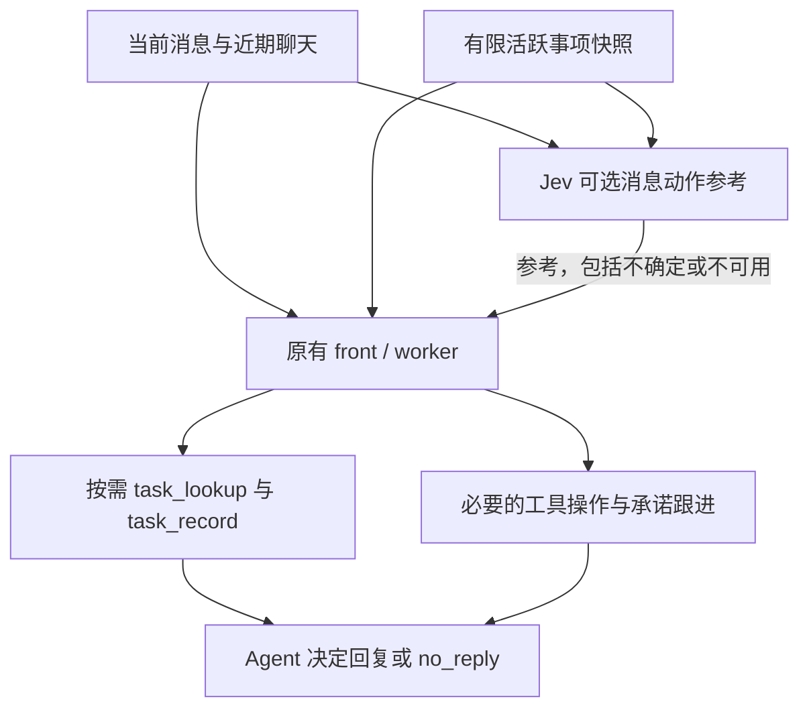

# Jev 消息动作参考：保留事项记忆的接入方式

Jev 是可选的消息动作分类器，默认关闭。接入位于稳定消息批次之后、front/worker 之前；它读取当前消息、近期聊天及既有活跃事项快照，返回一个 Choice 参考。它不会创建 silent 结果、消费输入、替换原消息、选择业务工具或写入事项。

## 为什么不按“无需回复”跳过 Agent

“联调完成，不用回复”可能需要把 waiting 事项改为 completed；“已部署”可能触发之前承诺的验证。需要回复、需要执行、需要更新记忆是不同的判断。即使 Jev 高置信返回 ack_only，front/worker 仍然运行，使用原有 task_lookup/task_record，再自行决定是否 no_reply。



每个稳定批次只请求一次，front 升级和 Worker 备用链复用判断；front 已消费补充时，后续 Worker 不再携带旧判断。运行中的补充沿用原生 steer 与事项证据上下文刷新，不额外添加每步模型复审。重规划后的新批次重新判断。

同时修复一处直接相关的既有交接缺口：Worker 收到 steer 补充后失败时，备用模型现在接收这些补充，最终结果也保留其消息集合供宿主消费。出现补充时清除原 Jev 判断。事项证据 ID 仍由原有 task 工具校验。

## 启用

在现有 `.env` 中配置 `TYPESAFE_API_KEY`，然后在 `config.json` 添加：

```json
{
  "jev": {
    "enabled": true,
    "model": "jev-1.14.0",
    "api_key": "${TYPESAFE_API_KEY}"
  }
}
```

复用既有环境变量解析与配置加载；不增加 SDK 依赖。未配置 `jev` 或 enabled=false 时不调用 Jev、不追加提示。示例配置默认关闭；启用前同时填写示例 `.env` 的可选 key。通过现有服务重启流程加载此配置，Dashboard 不新增开关。

本次不增加 Pi 扩展或新工具，沿用上游已安装 Pi 的 no_reply/task_record/task_lookup 协议，不额外要求 Pi 升级。其他后端仍保留其原有能力；需要事项记忆时使用上游支持事项工具的 Pi 工作流。

启用后，当前消息、配置范围内的近期聊天和最多 8 条活跃事项摘要会发送到 TypeSafe API。图片/文件只传已有文字引用，不上传附件。调用采用一次 HTTP 请求、5 秒网络超时和 6 秒等待上限，无自动重试。网络/协议故障以 unavailable 参考返回，Agent 按原输入继续；取消仍正常传播。它是可选能力，不会回退到另一个分类模型。

## 判断与限制

- 当前仅包含通用 message_action：new_request、supplement、correction、status_query、notification、cancel、ack_only、ambiguous。没有企业业务路线或工具权限分类。
- Choice 分布经校验后取值；低于 0.9 的 confidence 仅显示 ambiguous。这是保守的参考阈值，不是业务成功率，也不是经本项目实测校准的最佳阈值。
- 活跃事项有数量和归档边界。请求显式说明快照不完整，Agent 保留 task_lookup；不能把快照里没有事项当作没有既有承诺。
- Jev 参考只描述该批初始输入。新的事项事实和后续补充优先。front 写入的事项会在 Worker 启动时正常重载。
- 避免了“分类直接跳过事项写入者”的结构性遗漏，不保证生成模型必然正确使用 task_record 或完成所有承诺。
- 此接法没有减少 Agent 启动次数，增加了一次网络往返。分类价值与净时延需业务样本对照，不能宣称已提速。
- 原有确定性门控、人工接管、事项归档与历史窗口保持现状；本改动不声称修复所有既有记忆局限。

API 依据：[HTTP](https://docs.typesafe.ai/api/system-one)、[Choice](https://docs.typesafe.ai/primitives/choice)、[模型](https://docs.typesafe.ai/models)。

## 验证

```sh
PYTHONPATH=src:tests python -m unittest test_jev -v
PYTHONPATH=src python -m unittest discover -s tests -v
```

Windows PowerShell 用 `$env:PYTHONPATH='src;tests'` 后运行对应 `python -m unittest` 命令。

专项测试使用替身模型与临时数据库，不访问 DWS/ERP。覆盖高置信 ack 仍更新事项后 silent、front 更新后 Worker 重载、Jev 失败仍执行、默认关闭、备用链保留补充、真实 `_run_agent` 的 prompt/steer 及证据映射、Choice 校验和取消传播。模型替身验证调用链，不证明真实分类准确率。

2026-11-06 验证结果（Windows，Python 3.14）：

- 新增专项 13/13 通过，独立审查的 HTTP 截断和备用链补充遗漏已修正并复验。
- 完整测试 186 项：178 通过、8 errors、0 assertion failures。干净上游 `64f3443` 对照 173 项：165 通过、相同 8 errors、0 assertion failures。8 项均为测试退出清理临时 SQLite 时的 WinError 32 文件占用，涉及 DashboardTests 1 项、SilentOutcomeTests 3 项、TaskSnapshotTests 4 项；没有把完整测试宣称为全通过。
- 真实 Jev 1.14 API 仅使用 3 条合成输入：完成通知→notification（0.92），含等待验证承诺的部署通知→notification（0.99），文档整理请求→低置信 ambiguous（0.68）。三次接口均有有效响应；保留不确定结果，没有调低阈值。承诺是否执行由原 Agent 判断，不由 notification 标签决定。
- 未调用真实执行模型、未发消息、未做真实业务操作；没有端到端效率或中文分类准确率结论。
